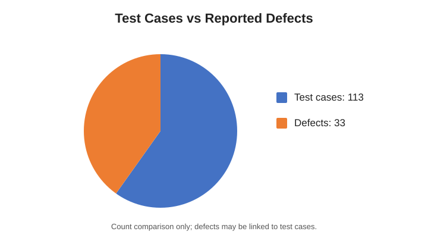

# FrontAccounting Website – Manual Testing

## Project Overview

This project involved manual testing of the FrontAccounting website to verify key workflows, check expected behaviour, and identify defects.

**Website:** [FrontAccounting – Quastech Project](https://quastechproject.com/projects/frontaccounting/index.php)

## Modules Tested

### 1. Login
- Login functionality

### 2. Sales
- Sales Quotation
- Sales Order
- Delivery Against Order
- Invoice Against Order
- Customer Payments

### 3. Purchase
- Purchase Order Entry
- Receive Purchase Order
- Supplier's Invoice
- Supplier's Payments

### 4. Items and Inventory
- Inventory Location Transfers
- Item Inventory Management
- Item Inventory Status

## Types of Testing

- **Black-box testing:** Validated functionality through inputs and outputs without examining the internal code.
- **Functional testing:** Checked whether the selected features behaved according to their expected requirements.
- **Integration testing:** Checked interactions between related workflows or modules where applicable.
- **Positive and negative testing:** Checked expected inputs as well as invalid or unexpected inputs where applicable.

## Testing Summary

| Metric | Count |
|---|---:|
| Test cases | 113 |
| Defects reported | 33 |

A total of 113 test cases were documented/executed across the four modules, and 33 defects were reported. The pie chart below compares the two reported counts; it does not represent pass/fail percentages because defects may be associated with test cases.

## Testing Approach

- Executed manual checks across the selected modules.
- Compared actual behaviour with expected results.
- Recorded defects with clear descriptions for review and tracking.

## Project Scope

The project focused on manual functional testing of the Login, Sales, Purchase, and Items and Inventory modules. Results were documented in a bug report for further investigation.
